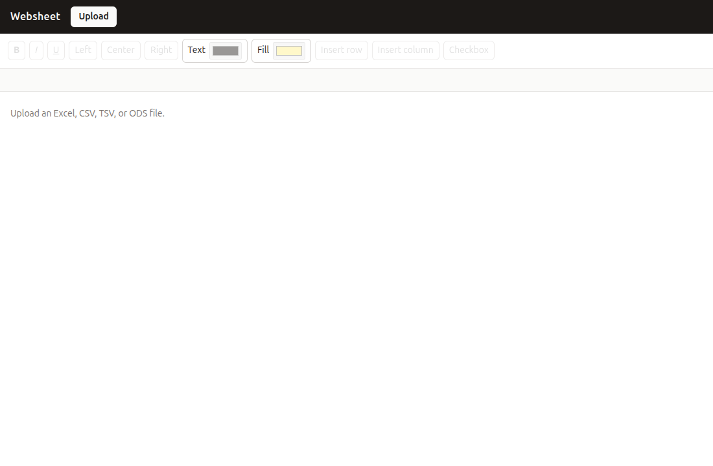
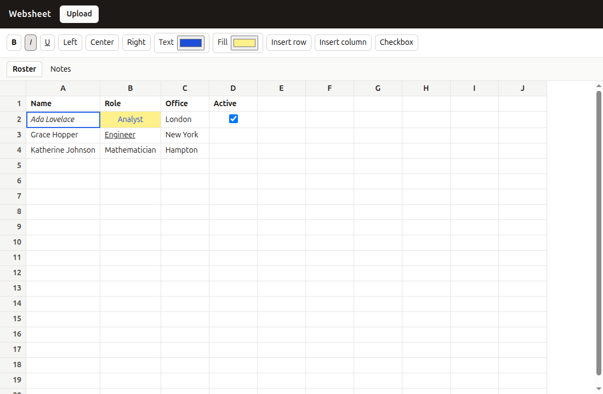
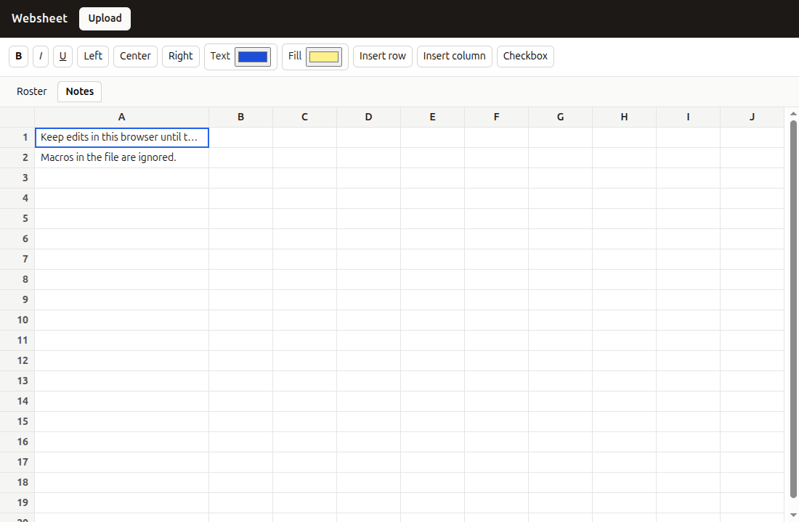

# Websheet

Websheet opens an Excel, CSV, TSV, or ODS file in the browser and shows it as a cell grid. You can switch sheets, edit cells, and format them. The workbook stays in this browser until you upload a different file.

There is no build step and no account. The page is plain HTML, CSS, and JavaScript. [SheetJS](https://cdn.sheetjs.com/) reads the file. Macros in the file are ignored.

## Screenshots

Before a file is loaded, the toolbar is disabled:



After an upload, each sheet is a tab. This roster uses bold headers, italic text, a colored cell, underline, and a checkbox:



Another sheet in the same file:



## Run

Serve the project directory over HTTP. Opening `index.html` as a file will not load the scripts.

```bash
python3 -m http.server 8770
```

Then open http://127.0.0.1:8770/. The first load also fetches SheetJS from the network.

## Use

Upload `.xlsx`, `.xlsm`, `.xls`, `.csv`, `.tsv`, or `.ods`. A workbook with more than one sheet gets a tab per sheet. The grid scrolls up, down, left, and right. Column letters and row numbers stay in place while you scroll.

Click a cell to select it. Click it again, or press Enter, to type. Enter saves the text. Escape drops the edit. Arrow keys move the selection.

The toolbar applies to the selected cell:

- **B**, **I**, and **U** toggle bold, italic, and underline
- **Left**, **Center**, and **Right** set horizontal alignment
- **Text** and **Fill** set the text color and the background color
- **Insert row** adds a row above the selection
- **Insert column** adds a column to the left of the selection
- **Checkbox** turns the cell into a checkbox

A checkbox cell does not open the text editor. Checking it stores the cell as checked.

Edits are written to `localStorage` and come back when you reload the page. Uploading another file replaces that saved workbook. A file that is not a real spreadsheet is rejected, and the sheet you already have stays on screen.

Websheet does not download or export the workbook. Formula cells show the value that was saved in the file. Colors and fonts from the file are not imported; formatting you apply here is what is kept.

## Files

| File | Role |
| --- | --- |
| `index.html` | Page shell, toolbar, and the SheetJS script |
| `css/app.css` | Layout, sticky headers, and the scrollable grid |
| `js/model.js` | Workbook data, edits, and `localStorage` |
| `js/import.js` | Turns an uploaded file into that workbook |
| `js/view.js` | Draws the grid, selection, and cell editor |
| `js/main.js` | Connects upload, sheet tabs, and the toolbar |
